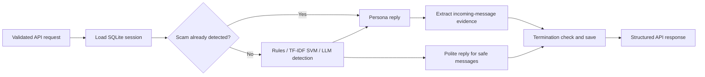

# ScamBait AI

ScamBait AI is a collaborative hackathon prototype for inspecting suspicious messages through a Python API. It detects scam patterns, generates a conversational reply, and extracts candidate contact and payment identifiers for later review. It is intended for controlled demonstrations with synthetic messages.

## Current implementation

- FastAPI endpoints at `/honeypot` and `/api/v1/honeypot` with a shared response schema.
- A LangGraph workflow for loading sessions, detection, replies, extraction, and persistence.
- Rules, a small TF-IDF/LinearSVC classifier, and an LLM fallback for ambiguous messages.
- Cerebras or Groq persona generation, with a scripted reply when generation fails.
- Regex extraction from incoming `scammer` messages only. Generated persona replies are excluded from evidence.
- SQLite persistence, per-session request serialization, and a process-local concurrency limit of 30.
- Development callback dry runs; production mode can send a final result to the configured-in-code GUVI hackathon endpoint. Digital-arrest alerts write a local log; there is no verified law-enforcement integration.

The project was built for the GUVI Hackathon 2026 according to its repository history. No award, adoption, production readiness, or field accuracy is claimed here.

## Contribution and attribution

This is team work. Commit history includes Diya Virmani ([diyaavirmani](https://github.com/diyaavirmani)), Maaz ([somewherelostt](https://github.com/somewherelostt)), and Ankit Singh Raghuvanshi. Commits bearing Ankit's name cover extraction, workflow tuning, and engagement thresholds; [633719b](https://github.com/Raghuvansyn/HoneyPot-Scam-Detection/commit/633719bb055c5858c6f34a544d2607cbb711ed55) and [70e699d](https://github.com/Raghuvansyn/HoneyPot-Scam-Detection/commit/70e699d9acbedae15e042381baaca4bb51788564) are examples. The Raghuvansyn account maintains this portfolio copy and its documentation. This history does not establish sole authorship.

The reliability batch adds API failure handling, evidence provenance checks, database isolation, regression tests, and a reproducible offline demonstration. Existing collaborator work, provider acknowledgments, and the [MIT license](LICENSE) are preserved.

## Architecture



[Architecture and tradeoffs](docs/architecture.md) describe the actual routing and stopping conditions. Conversation history supplied by clients is currently ignored; the server appends each new message to its own persisted history for that `sessionId`. Use a fresh ID for an independent conversation.

## Install and run

Python 3.11 is the version family specified by `.python-version`. Clean setup, dependency checks, and offline workflows were verified locally on Python 3.11.15 and 3.13.0. Use an isolated environment:

```bash
git clone https://github.com/Raghuvansyn/HoneyPot-Scam-Detection.git
cd HoneyPot-Scam-Detection
python3 -m venv .venv
source .venv/bin/activate
# PowerShell: .venv\Scripts\Activate.ps1
python -m pip install -r requirements-dev.txt
python -m pip check
```

`requirements.txt` contains runtime dependencies; `requirements-dev.txt` also installs the offline verification tools. No downloaded dataset or pretrained model file is needed: the small SVM trains lazily on 115 strings embedded in `src/agents/detection.py`.

For live generation:

```bash
cp .env.example .env
# Edit .env: choose a private API_KEY and set a valid provider key.
# Keep MODE=dev for demonstrations; it disables outbound GUVI callbacks.
python run.py
```

Open `http://127.0.0.1:8002/docs`. The launcher binds to `0.0.0.0`; configure `API_KEY` before exposing it outside your machine. Send it in the `x-api-key` header. With no configured key, development mode permits local requests. Production requests fail with HTTP 503 if the API key is missing or set to the old placeholder.

| Setting | Purpose |
|---|---|
| `API_KEY` | Shared access key for the API; never commit a live value |
| `CEREBRAS_API_KEY` | Preferred provider when present; model ID is `llama3.1-8b` |
| `GROQ_API_KEY` | Used if Cerebras is not configured or fails during client initialization; model ID is `llama-3.1-8b-instant` |
| `MODE` | Defaults to `dev`; only `prod` enables GUVI transmission |
| `DATABASE_PATH` | Writable SQLite path; defaults to `honeypot.db` |

Provider/model availability is unverified. A Cerebras inference failure does not automatically retry Groq. Ambiguous detection without a working provider returns HTTP 503 rather than a fabricated safe verdict. Persona generation alone can fall back to scripted text. API workflow timeouts return 504; invalid input returns 422 and incorrect keys return 401. Callbacks and request logs may contain message content; use synthetic data for demos.

## Representative example

With the local server running and your API key exported:

```bash
curl http://127.0.0.1:8002/api/v1/honeypot \
  -H 'Content-Type: application/json' \
  -H "x-api-key: $API_KEY" \
  -d '{"sessionId":"demo-001","message":{"sender":"scammer","text":"URGENT! Send money to demo@paytm immediately.","timestamp":"2026-01-01T00:00:00Z"}}'
```

`demo@paytm` is a synthetic text fixture: never send a payment. A live reply depends on the configured provider. For a demonstration requiring no credentials or network:

```bash
python -m examples.offline_demo
```

This uses the real API, graph, rule detection, extraction, and SQLite store. **Only the persona provider is mocked**, and the callback is a development dry run. Nine incoming fixture messages and nine generated replies reach the 18-message threshold for a session with one extracted evidence category. The client stops at the first closed response. Actual verified output includes:

```json
{
  "mode": "offline provider fixture; callback dry run",
  "requests": 9,
  "scamDetected": true,
  "upiIds": ["demo@paytm"],
  "sessionStatus": "closed",
  "totalMessagesExchanged": 18
}
```

This is a selected summary of the script's nested output, not a live model result. It verifies application wiring and persistence, not the realism or quality of generated conversation.

## Tests, evaluation, and evidence

```bash
python -m pytest -q
python -m examples.offline_demo
python -m evaluation.scripts.offline_detection
python -m pip check
```

All 17 offline tests passed on both verified Python versions. The default pytest suite is `tests/offline`. It verifies API errors and auth, bounded input, same-session serialization, database isolation/persistence failure, extraction provenance, malformed/valid model response parsing, normalization, spoofed brand/warning text, and a complete graph workflow. The other scripts in `tests/` are historical manual/live probes; they are not collected by default.

The 16-case synthetic detection probe has 8 positive and 8 negative labels, no exact embedded-training-string duplicates, and no live LLM. The local run produced 8 true positives, 3 true negatives, 1 false positive, and 4 abstentions requiring an LLM. The neutral bank-discussion case is a known false positive. These deliberately small regression cases do not establish general accuracy. Heuristic confidence values and SVM margins are not calibrated probabilities.

See [evaluation method and limitations](evaluation/README.md). There is no supported throughput, cost, production availability, or comparative accuracy result. The committed CI workflow runs offline checks on Python 3.11 and 3.13; its presence alone does not establish that remote CI passed.

## Limitations and next work

- The classifier uses a tiny, manually embedded corpus with no held-out model-selection/test procedure. Near-duplicate training/evaluation templates and class balance have not been audited statistically.
- Keywords, trusted-message templates, and regex extraction can create false positives and false negatives. Extracted links are candidates, not verified phishing sites or confirmed criminal identities.
- Output filtering catches a limited set of sensitive patterns. It does not prove freedom from hallucination or prompt injection.
- SQLite calls are synchronous; locks and the semaphore protect one Python process only. Database errors now surface instead of silently discarding state. There is no multi-worker coordination, request idempotency, retention policy, or durable callback retry queue.
- Development callback success means a skipped transmission. Production callback failures close the session and are not durably retried.
- The historical Railway URL has not been verified; no hosted demo is advertised as available. `render.yaml` describes a potential deployment and needs environment configuration and a persistence plan.

Next work: rotate previously published credentials, independently label a broader detection set, compare calibrated baselines, add provider integration checks, distinguish generated and fallback replies in response metadata, and design durable session/callback handling before deployment.
